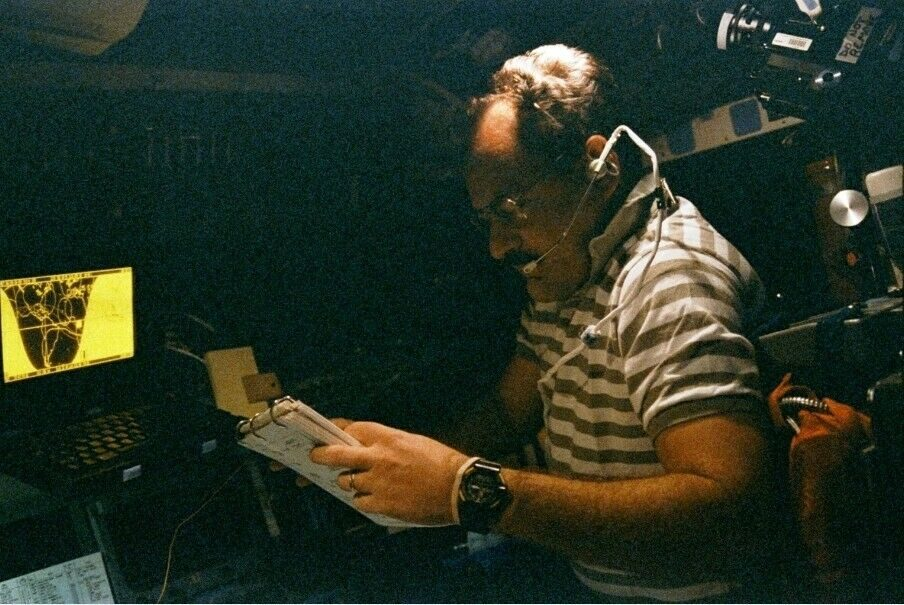

# NASA SPOC Emulator

Бортовой компьютер SPOC (Shuttle Portable Onboard Computer) космических челноков NASA: загрузочная дискета ноутбука GRiD Compass запускается прямо в браузере через x86-эмулятор [v86](https://github.com/copy/v86). Всё статическое: без backend и сборки.

## Управление

Работает только с физической клавиатурой; сначала кликните по экрану.

- **CODE** в SPOC — это `Alt` (на Mac `Option`).
- `Enter` (RETURN) — следующее поле формы; `Alt`+`Enter` (CODE-RETURN) — подтвердить форму и перейти дальше.
- `Alt`+`Backspace` — стереть значение поля целиком; `Backspace` — один символ.
- `Alt`+`Esc` — отмена / назад; `Alt`+`?` — справка по экрану (на карте — список функций).
- Стрелки — выбор пункта меню.
- Кнопки под экраном: «Перезапуск», «Пауза», «На весь экран».
- Touch: без подключённой клавиатуры вводить нельзя, экранной клавиатуры нет.

## Что вводится при запуске

Программа 1980-х принимает только годы до 2000-го: время запуска < время вектора состояния < текущее время, а между вектором и текущим временем не больше двух суток. После загрузки идут три формы:

1. **Launch Time Update** — время старта миссии по GMT (год 1983–1999, день года, часы, минуты, секунды); от него считается MET (время, прошедшее с запуска).
2. **GMT Update** — текущее время по GMT (день, часы, минуты, год). По умолчанию подставляется дата вашего компьютера (2026), её нужно заменить на год до 2000-го. Предупреждения «Vector more than 2 days old» / «Vector is in the future» подтверждаются `Alt`+`Enter`.
3. **State Vector Update** — положение (X, Y, Z, тысячи футов) и скорость (X, Y, Z, тысячи футов в секунду) корабля в системе M50 и момент времени, к которому они относятся. Контрольная проверка показывает наклонение и высоты апогея/перигея.

Демо из руководства (каждое поле: `Alt`+`Backspace`, значение, `Enter`; в последнем поле формы `Alt`+`Enter`; перед вводом дождитесь, пока форма нарисуется):

| Форма | Поля |
|---|---|
| Launch Time Update | Year 1988, Day 300, Hour 0, Minute 0, Second 0 |
| GMT Update | Day 300, Hour 0, Minute 0, Year 1988 |
| State Vector — время | Day 300, Hour 0, Minute 0, Second 0 |
| State Vector — позиция | X -4065.5451, Y 19478.6516, Z -9134.2843 |
| State Vector — скорость | X -23.4998543, Y -7.6119311, Z -5.7686384 |

После GMT появится «Vector is in the future» — `Alt`+`Enter`. Проверка должна дать `Inclination = 28.518`, `HA=166; HP=159` — `Alt`+`Enter`. Затем главное меню → Display World Map (`Alt`+`Enter`) → Invoke Default Communication Sites (`Alt`+`D`) → карта мира.

## Роль SPOC в истории

С первого полёта (STS-1) независимые расчёты на борту челнока делал калькулятор HP-41: одна программа в памяти, без графики. В 1983 году NASA выбрало коммерческий ноутбук GRiD Compass 1101, и на STS-9 он впервые полетел как проверка идеи. SPOC оказался так полезен для ситуационной осведомлённости экипажа, что летал на каждой следующей миссии, а с 41-G — по два комплекта (основной и резервный).

- Показывал карту мира, положение корабля, границу дня и ночи, текущую и две будущие трассы, время входа в зону связи и выхода из неё (AOS/LOS) для наземных станций и спутников TDRS, восход и закат на орбите. Позже добавились резервный расчёт посадки и схода с орбиты на случай потери связи, а также управление центровкой.
- Экономил время Центра управления полётом: не нужно было передавать таблицы голосом или телетайпом. Пилот STS-9 Брюстер Шоу: «Это действительно большое преимущество — всё время знать, где мы находимся».
- Ноутбуки дорабатывали: вместо модема — вентилятор, защита батареи часов, экран против излучения. Модели менялись: 1101, затем 1129 (STS-51C), затем 1139 (STS-51G) с экраном 7,5×3,5 дюйма. Электролюминесцентный дисплей светился янтарным — отсюда цвет экрана здесь.
- Формально «некритичное, но обязательное» оборудование: отказ не угрожал миссии, но без него работать было сложнее.

Источник фактов — Shuttle Portable Computer Flight Procedures Handbook (приложение E, входит в образ дискеты).

## Особенности

- Экран в пропорциях дисплея GRiD Compass 1139 (около 15:7), янтарная окраска делается CSS.
- Клавиатура обрабатывается отдельно: программа опрашивает клавиши по таймеру, поэтому каждое нажатие превращается в импульс фиксированной длины, а автоповтор браузера игнорируется.
- Стандартный v86 не умеет 16-битные `FSAVE`/`FRSTOR` и `FBLD`, на которых программа зависает. В `assets/v86.wasm` лежит пересобранная версия; патч — `assets/v86-fpu.patch` (база: v86 commit `315b2b0`).
- Все файлы локальные (`assets/`), CDN нет, после загрузки работает offline. При ошибке загрузки показывается сообщение с кнопкой «Повторить».
- v86 распространяется под BSD 2-Clause, лицензия в `assets/V86_LICENSE.txt`.

## Ссылки

- [Видео-демонстрация на YouTube](https://www.youtube.com/watch?v=quHlMiwTQZs)
- [SPOC-VirtualBox на GitHub](https://github.com/robertely/SPOC-VirtualBox)
